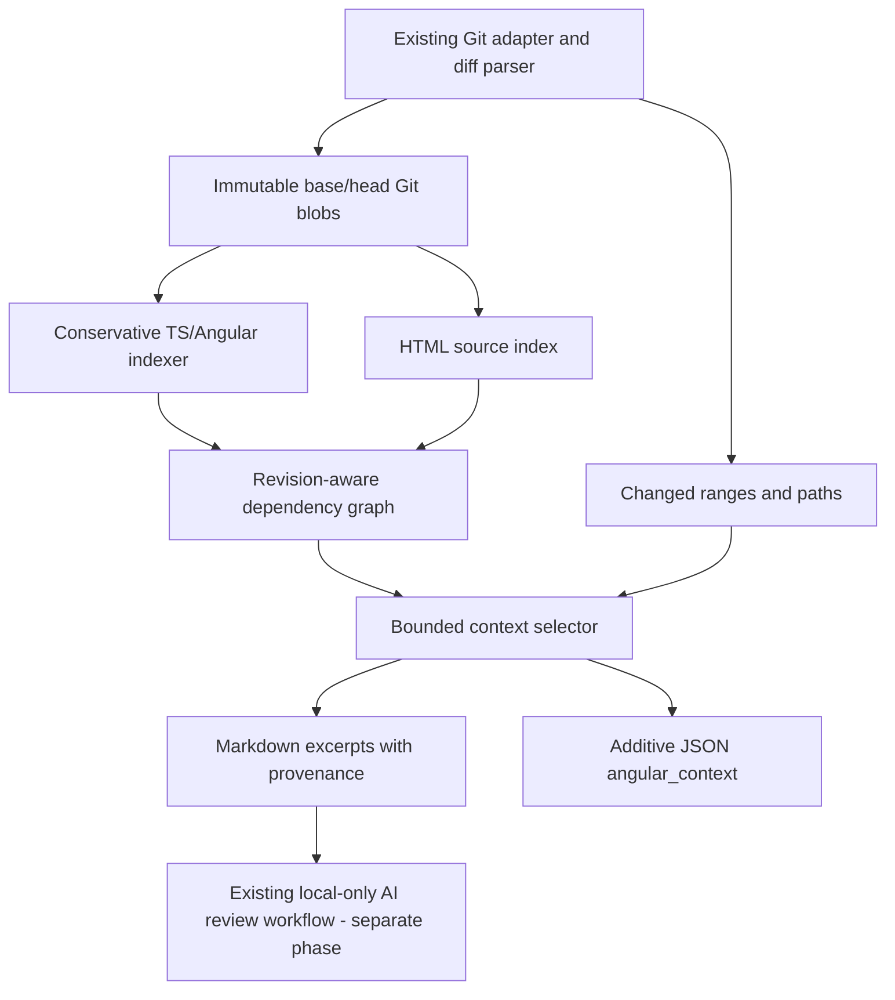

# Architecture



Suggested responsibilities (adapt to actual repository layout, do not force renames): `typescript_index.py`, `angular_index.py`, `dependency_graph.py`, `context_selector.py`, `context_report.py`.

## Example additive JSON (illustrative schema, not existing output)
```json
{
  "schema_version": "1.1",
  "angular_context": {
    "status": "partial",
    "analysis_method": "conservative_lexical",
    "nodes": [],
    "edges": [],
    "selected": [],
    "omitted": [],
    "warnings": [],
    "coverage": {"typescript_semantic": "partial", "template_bindings": "unsupported"}
  }
}
```

`selected` items should carry `revision`, `commit`, `path`, `line_start`, `line_end`, `reason`, `confidence`, and `content` or a content reference. Protect against runaway JSON size by making inline excerpts bounded.

## Dependency policy
Confirmed: directly parsed literal relative import resolving to a unique Git object, explicit templateUrl, explicit module declaration references. Candidate: selector usage, symbol name matching or nontrivial NgRx cross-references. Unknown: dynamic imports, computed templates, advanced TS syntax not reliably parsed.
