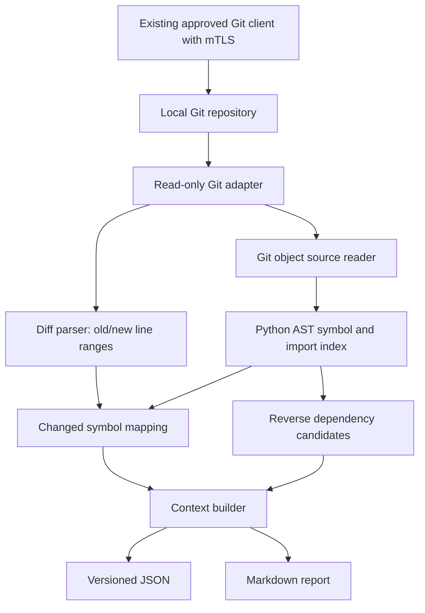

# Architecture v1.0

Modules: `cli.py`, `git_adapter.py`, `diff_parser.py`, `python_indexer.py`, `dependency_index.py`, `parse_cache.py`, `context_builder.py`, `reporters.py`, `models.py`, `__main__.py`.

Use stable typed data structures. Keep Git bytes/path encoding concerns inside adapter. Never run source repository code. The import index walks each selected commit once and keeps a reverse map from module name to importers. `--cache` stores that commit's parse, keyed by commit id, parser version, and import roots. Source bytes are not retained after each read chunk.
